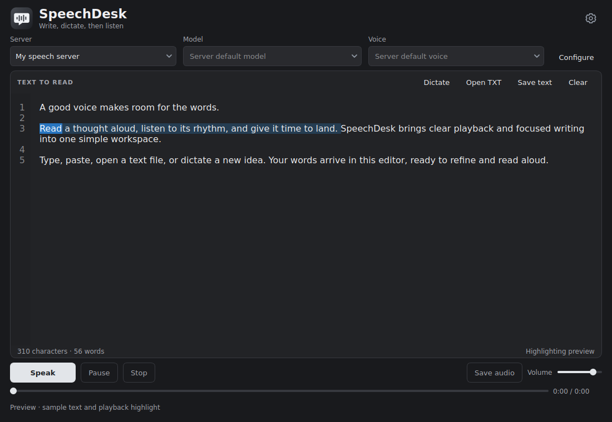
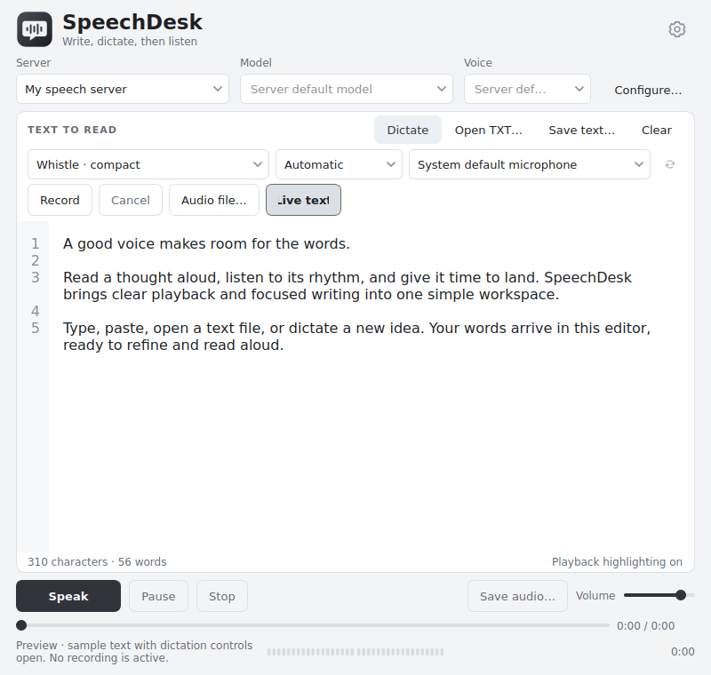

# SpeechDesk

**A native desktop reader with hosted text-to-speech and local dictation.**

SpeechDesk 1.0.0 brings typing, text files, microphone dictation and speech playback into one editor. Choose OpenAI, ElevenLabs, OpenRouter or a compatible speech server; listen inside the application, follow the highlighted passage and save the completed reading as WAV.

[Releases](https://github.com/Davoda1/Speech-Desk/releases) · [Online manual](https://davoda1.github.io/Speech-Desk-Manual/) · [User guide](docs/User-Guide.md) · [Speech providers](docs/Server-Profiles.md) · [Optional models](docs/Optional-Models.md)

| Dark theme | Light theme |
| --- | --- |
|  |  |

## Features

- One editor for typed, pasted, imported and dictated text.
- OpenAI, ElevenLabs and OpenRouter profiles, plus local or remote self-hosted speech services.
- Entirely local speech recognition with bundled Whistle and multilingual Whisper Tiny, Base and Small models.
- Optional Whisper Large v3 Turbo and Large v3 models, imported from separate ZIP packs.
- Pause, resume, stop, section seeking, volume control and full-reading WAV export.
- Word highlighting when the service supplies supported timing data; section highlighting otherwise.
- System, light and dark themes; resizable panels; native C++17 / Qt6 interface.
- No application telemetry. Provider credentials are kept for the current session only.

TTS requires a configured service that actually generates speech. A generic text-chat endpoint is not sufficient. Hosted services use the user's own account and may charge for requests; speech-to-text audio stays on the local computer.

## Install

Choose an available package from [Releases](https://github.com/Davoda1/Speech-Desk/releases) and verify it against the release's single `SHA256SUM.txt` file.

| Platform | Package | Start |
| --- | --- | --- |
| Windows 10/11 x64 | `SpeechDesk-1.0.0-Windows-x64.zip` | Extract everything and open the root `SpeechDesk.exe` |
| Linux x86-64 | `SpeechDesk-1.0.0-Linux-amd64.tar.gz` | Extract and run the top-level `speechdesk` executable |
| Debian/Ubuntu amd64 | `SpeechDesk-1.0.0-Linux-amd64.deb` | Install with a package manager; launch SpeechDesk |

Runtime packages include Qt and the four default recognition models. Keep the executable, libraries, plugins and resources together. No Python or separate Qt installation is required to run a packaged application. Windows Unicode recognition paths require Windows 10 version 1903 or newer. Linux needs a graphical desktop, audio service and the system dependencies listed by the package; see [runtime details](docs/Native-Engines.md).

```sh
sudo apt install ./SpeechDesk-1.0.0-Linux-amd64.deb
```

The Debian package installs a real executable at `/usr/bin/speechdesk`. Portable packages start the real executable directly, without a launcher script.

## First reading

1. Open **Settings → Servers** and choose a provider preset, or enter a self-hosted server address.
2. Enter your API key when required, then select or enter a model and voice supported by that service.
3. Use **Detect capabilities** where supported. Discovery does not generate speech or establish synthesis compatibility.
4. Save settings, type or open text, and press **Speak**. Select a passage first to read only that selection.
5. Use **Dictate** to insert locally recognized words into the same editor. Dictation does not start TTS automatically.

Playback is AI-generated speech. The selected TTS service receives the text requested for synthesis. Each section is buffered before playback, with the next section prefetched where possible. Stop cancels client work but cannot guarantee that a remote service stops processing or billing an accepted request.

## Build from source

Requirements: CMake 3.21+, a C++17 compiler, Qt 6.4+ with Core, Gui, Widgets, Network, Multimedia and Svg; Linux also requires Qt DBus. Focused tests need Qt Test and Python 3; asset bootstrap requires Python 3.12+. Qt 6.8.3 is the packaging target. Binary models and generated native assets are excluded from Git.

```sh
cmake -S . -B build -DCMAKE_BUILD_TYPE=Release -DSPEECHDESK_BUILD_TESTS=ON
cmake --build build --parallel 4
ctest --test-dir build --output-on-failure --timeout 90
```

This builds the application and fixture tests. Local dictation additionally requires the pinned recognition assets and the audio helper. On a Linux build host, run `python3 vendor/tools/bootstrap_native.py --platform all`, then `cmake --build build --target stage_resources`. [Native engines](docs/Native-Engines.md) describes acquisition, source reconstruction and staging. Build and packaging scripts live in `packaging/` and `vendor/tools/`; release workflows are defined in `.github/workflows/`. The manually dispatched **Release packages** workflow creates application packages, complete model add-ons, source archives, and one checksum manifest, then attaches them to a draft release for review.

## Privacy, compatibility and support

Preferences and imported models live in `%AppData%\Speech-Desk` on Windows and `$XDG_CONFIG_HOME/Speech-Desk` (normally `~/.config/Speech-Desk`) on Linux. Editor text and generated audio are not automatically retained. Temporary audio is cleaned up on normal completion or exit.

Session API keys and standard authentication headers are omitted from saved/exported profiles. Custom request fields can persist: use the dedicated API-key field for secrets. Service-side retention and billing policies are separate from SpeechDesk. See [provider details](docs/Server-Profiles.md) and [security guidance](SECURITY.md).

Supported APIs, models and voices can change. Compatibility is specific to the configured endpoint, model and response format. See [verification scope](docs/Verification.md) for the distinction between automated fixtures, live service checks and physical-device checks. Report reproducible problems through [Issues](https://github.com/Davoda1/Speech-Desk/issues) using synthetic text and redacted diagnostics.

## License

SpeechDesk application code is licensed under [MIT](LICENSE.txt), copyright © 2026 davoda1. Third-party engines, models, Qt, FFmpeg and other runtime components retain their own licenses. Their notices are included in `vendor/licenses/` and distributed runtime packages; see [Native engines](docs/Native-Engines.md).
